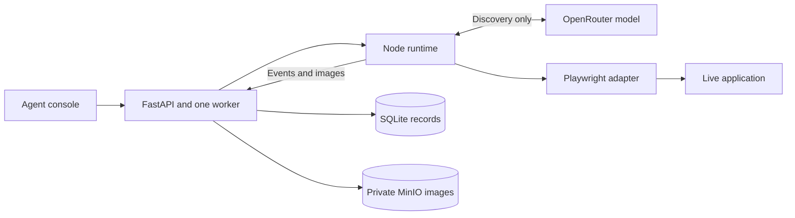
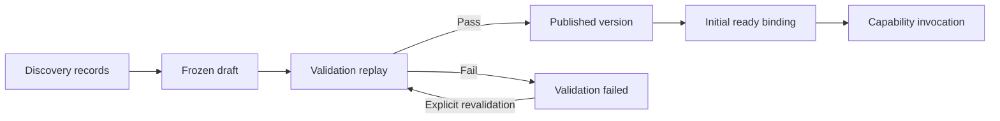
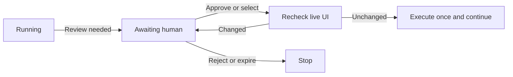

# Architecture

I built a runtime that discovers a task through a real browser and replays the recorded flow with new inputs, without model decisions. Meridian, a synthetic banking application, provides search, account and contact-editing workflows.

FastAPI owns admission, persistence and publication. Node owns browser execution, typed tools, discovery and replay. This separates lifecycle rules from agent decisions. SQLite and one in-memory worker keep deployment small: one active browser and 16 queued jobs. Review occupies the worker; restart interrupts unfinished runs without repeating potentially dispatched actions.

Before discovery, the model proposes a capability name, description and example inputs; the runtime derives their types. The loop observes DOM-derived controls and screenshots, proposes tools, and executes them sequentially through validation and policy checks. OpenRouter keeps the vision/tool-calling model configurable. Each task binds one adapter and defaults to 40 tool calls, including rejected proposals. Provider history trims old observations but preserves extracted results; the audit retains full records.

The target recorder supplies durable descriptions to in-memory execution records. The artifact builder converts those records into steps at successful `finish_task`; FastAPI persists the draft before completing discovery. Event acknowledgements follow persistence, so evidence failure stops further execution.

# Artifact schema

A capability is the ability to perform an operation, such as looking up a customer. An artifact is one versioned way to perform it. An app deployment identifies a tenant's installation, including its URL and UI variant. A binding selects the validated artifact for a deployment and capability.

Publication atomically creates or reuses the capability, assigns an artifact version and creates the first ready binding. Later versions leave that binding unchanged until explicit activation. The current discovery builder always proposes a new capability; backend support for reuse exists, but automatic selection of an existing capability remains future work.

The definition contains compatibility metadata, input/output contracts, entry point, steps, targets, checks, recoveries and output mappings. Bindings reference inputs, prior outputs, deployment configuration or templates. The Customer name textbox remains a stable target while its text references `inputs.customer_name`. Temporary control references and observation IDs stay out of the artifact.

Replay pins the artifact ID, version, definition hash and deployment configuration. Semantic targets describe controls and their scope; visual targets reference a stored crop and a relative click point. Audit screenshots belong to run events; reusable crops belong to artifacts. The [schema appendix](docs/report-schema-reference.md) shows all nine entities, their relationships and the nested runtime contracts.

There are limits to generated contracts today: input fields have primitive types, but generated output fields accept arbitrary JSON. The builder emits a final-tool-status checkpoint and leaves business outcomes, per-step checks and recovery declarations empty. The schema and replay engine support richer contracts; generating them from discovery is unfinished.

# Determinism & error handling

Replay resolves bindings, captures fresh UI state, resolves targets, executes the saved tool and evaluates its checks and outputs. It uses no model calls. Determinism applies to the execution rules; output values can change with application data.

Semantic targeting uses role, name, ancestor/frame scope and explicit row matching. Visual targeting uses `rgb-template-v1`, a recorded crop and a threshold of at least 0.95 at the recorded viewport and scale. It supports translation, but does not promise tolerance to zoom, theme or branding changes. Missing or ambiguous artifact targets pause for human selection or refresh; the choice affects only that execution.

| Condition                                                          | Response                                                                    |
| ------------------------------------------------------------------ | --------------------------------------------------------------------------- |
| Declared business outcome, such as a missing member                | Return its code and mapped outputs when its checks match.                   |
| Declared recoverable condition                                     | Run at most two saved waits or one saved recovery action, then check again. |
| Policy breach, uncertain dispatch, failed checks or invalid output | Stop with structured failure details and evidence.                          |

The first two paths require artifact declarations. Generated plans retain tool-level checks, but business verification needs observed results, ideally after reopening the record. Potentially dispatched writes are never blindly retried. HTTP idempotency prevents duplicate admission, not duplicate effects inside the target application.

# Heterogeneity & multi-tenant

The adapter separates UI perception and actions from orchestration and recorded steps. Playwright supports the current browser implementation, including frame-aware controls and screenshot targeting. Native support would require an OS accessibility/screenshot adapter, native target resolution and policy, plus generalizing the browser-only surface and URL-entry contracts.

One capability can have several artifact implementations. Deployment bindings provide the place to select one for a vendor release or tenant variant. Today validation and activation are limited to the source deployment. My next extension would validate a candidate on another deployment, specialize it as a new immutable artifact when needed, and activate it only after verification. Configuration versions and fresh entry checks help detect incompatible changes.

The existing capability invocation endpoint already selects a ready binding and starts replay. A calling agent could use a thin tool wrapper over this endpoint; MCP could expose the same catalog later. The wrapper would supply trusted deployment context and return outputs, business outcomes, failures or a pending review.

# Escalation & handoff

I chose approval and target selection to demonstrate manual control over execution within the take-home scope. The operator can stop an action, authorize it, or choose which observed control it should use. This exercises the same-session pause and continuation mechanism without first building browser streaming and remote input transport. Direct mouse and keyboard takeover remains a limitation of this version.

Before waiting, the runtime persists the proposed action, arguments, screenshot and state fingerprint. FastAPI stores the review; Node polls while keeping the browser, pending action and history alive. Approval permits a fresh state and target check before execution. Target-selection reviews are available under both policies. Decisions and subsequent actions remain in the audit; choices never modify the frozen artifact. Cancellation, expiry and process restart stop continuation.

The next step is embedding the same live browser in the console, with streaming, controlled input, an explicit agent/human owner, manual-action recording and revalidation on resume. Today the operator controls decisions while the runtime retains browser input; the extension would transfer direct input control too.

# Safety

For `READ_WRITE`, exact-host checks cover document navigation, redirects and frames; hard restrictions cannot be approved away. Explicit review requests, missing/invalid assessments and `auto_approve` confidence below 0.3 pause execution. At or above 0.3, auto-approval proceeds after hard checks. Confidence comes from the model and is not a calibrated safety guarantee. Replay reuses stored assessments without an LLM; required reviews are new for each run, but changed inputs can make an old assessment inappropriate.

`READ_ONLY` currently bypasses action/domain enforcement and assessment-based approval. Its name therefore does not guarantee that writes are blocked. Both modes retain reference freshness, target validation and execution limits. An enforced read-only allowlist is needed before handling real customer workflows.

The demo uses synthetic data. Provider and storage credentials remain server-side; captures omit password input values and images use private storage. General redaction of arguments, extracted values, page text and screenshots is not implemented. Private storage is not a substitute for redaction. The prototype also lacks API/operator authentication and tenant authorization; CORS only restricts browser origins.

# Cuts

I kept one worker and deferred crash recovery, distributed execution, native adapters and cross-tenant provisioning. This makes session ownership and failure behavior easier to inspect. The priority is to strengthen generated output types, business checkpoints and exception paths, restore enforceable read-only policy and redact sensitive content, then add the embedded live-session handoff.

Setup, replay and export commands are in the [README](README.md); focused human-review and target-selection verification is recorded in the [implementation notes](docs/human-review.md#verification). The [submission evidence](evidence/README.md) contains a genuine hosted discovery, its published artifact, validation, a changed-input replay and a missing-target replay rejected by the operator, with complete logs, screenshots and the recording. Local fixtures and mocked storage checks remain separate from that hosted evidence.
