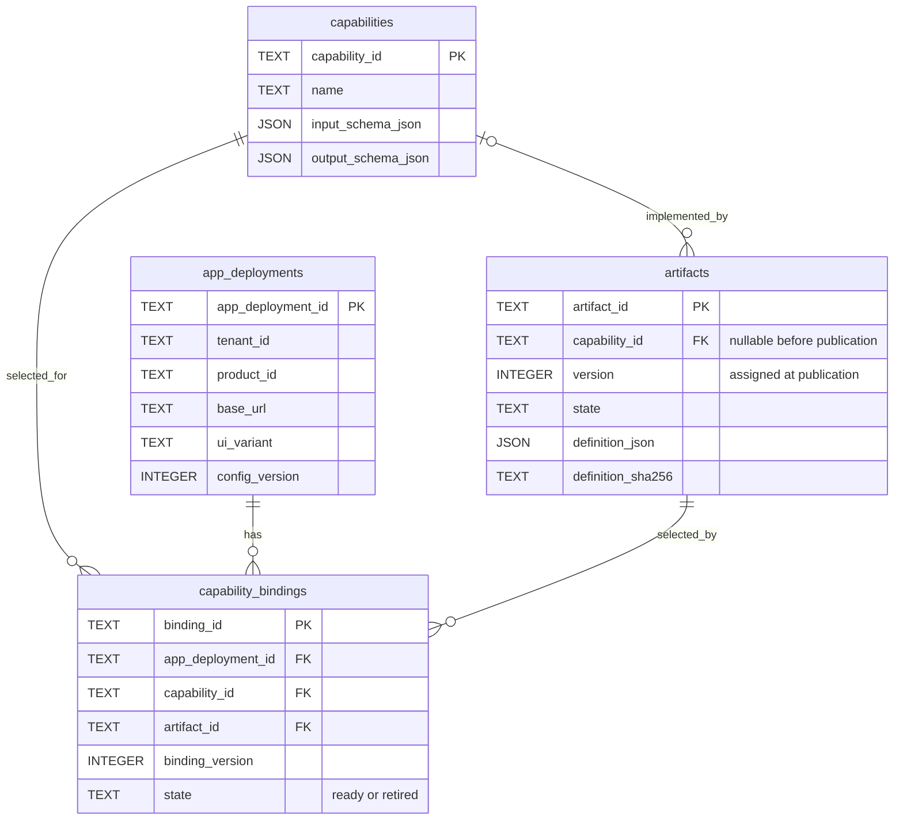
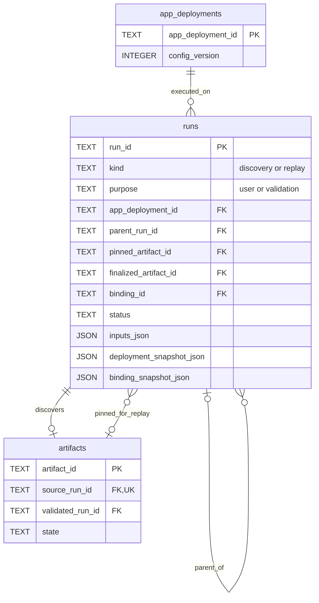
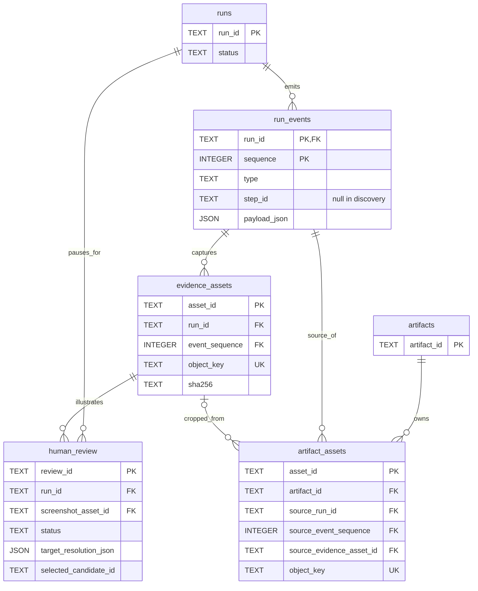
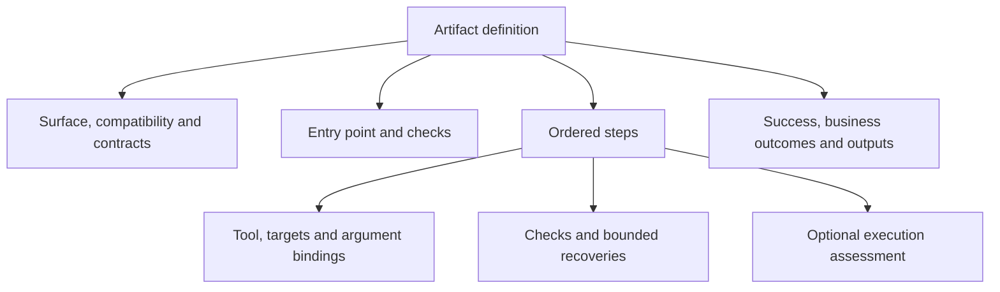
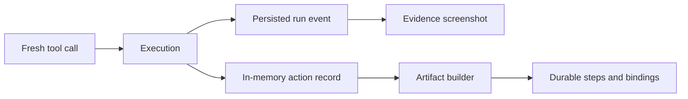

# Entity and artifact schema reference

This appendix supports [REPORT.md](../REPORT.md). It describes the current source contracts and SQLite schema through migration 0005. It is separate from the short design write-up so the report can explain decisions without listing every column.

## 1. Capabilities, deployments and bindings

A capability describes an operation. Its artifacts describe implementations. A binding selects one implementation for a deployment. The diagram shows identity and selection fields; the complete column definitions appear below.



There is at most one ready binding per deployment/capability pair. Historical bindings remain available. Tenant and product IDs are deployment attributes; there are no separate tenant or product tables. A draft proposing a new capability can have a null capability ID. Each published artifact has a unique capability/version pair. Publishing a later version does not silently switch an existing ready binding.

## 2. Runs and artifact lineage

A run records one attempt. Discovery can produce one artifact; a validation is a replay run whose `purpose` is `validation` and whose parent is the discovery run. Ordinary replay pins an already published artifact. Run snapshots preserve the selection even if a deployment or binding later changes.



The edges show source and pinned-execution relationships. Additional pointers, such as `validated_run_id` and `finalized_artifact_id`, are listed as fields to keep the diagram readable. Validation runs can pin drafts; normal user replay requires publication and eligibility. An artifact state is separate from its source run's status.

## 3. Audit evidence and human reviews

Events are ordered within a run. A screenshot belongs to an event; a reference crop belongs to an artifact and retains its source-event provenance. A review points to persisted evidence and the exact pending action.



`run_events` has a composite key `(run_id, sequence)`. Asset and review event references use both parts. There is at most one pending review per run. The operator's decision is recorded in `status`; `assessment_decision` records the model's recommendation. Target choice and action approval are separate concerns. Refreshing candidates does not execute the action, and selecting a candidate does not modify the artifact.

## 4. Executable artifact structure

Artifact identity, version, state and hash live in the database envelope. The following structure is stored inside `definition_json`. Its complete generated JSON Schema is [artifact.schema.json](../contracts/artifact.schema.json); [artifact.ts](../src/contracts/artifact.ts) defines structural and semantic validation.



| Field                           | Shape and purpose                                                                                                       |
| ------------------------------- | ----------------------------------------------------------------------------------------------------------------------- |
| `surface`                       | Currently the literal `browser`.                                                                                        |
| `compatibility`                 | `product_id`, `ui_variant`, nullable `vendor_release`.                                                                  |
| `input_schema`, `output_schema` | Closed JSON objects. Supported contracts include flat primitive types and objects with unconstrained JSON field values. |
| `entry`                         | A URL binding and entry checks. The generated builder uses deployment `base_url`.                                       |
| `steps[]`                       | `step_id`, `tool`, `arguments`, optional `target` and `execution`, plus `pre_checks`, `post_checks`, `recoveries`.      |
| `success_checks[]`              | At least one declared completion check.                                                                                 |
| `business_outcomes[]`           | `code`, `message`, `after_step_id`, matching `checks` and `output_mapping`.                                             |
| `output_mapping`                | Output names mapped to bindings, commonly `step_output` extraction values.                                              |

Executable step tools are `observe_ui`, `navigate`, `click`, `type_text`, `press_key`, `scroll`, `select_option`, `wait_for`, `check_ui` and `extract_data`. Discovery control tools such as `finish_task` and `request_human` are not artifact steps. A separate `request_human` during discovery does not automatically turn a later auto-approved step into a review-required step on replay.

| Binding kind  | Payload                                                                        |
| ------------- | ------------------------------------------------------------------------------ |
| `literal`     | `value`: JSON value.                                                           |
| `input`       | `path`: input field reference.                                                 |
| `step_output` | `step_id`, `path`: reference to a prior step's result.                         |
| `environment` | `path: base_url`: trusted deployment configuration.                            |
| `url`         | Environment base plus a validated relative `path`.                             |
| `template`    | Ordered `parts` containing bindings that resolve to primitive text components. |

| Durable target kind | Stored description                                                                                                                               |
| ------------------- | ------------------------------------------------------------------------------------------------------------------------------------------------ |
| `semantic`          | Role, name binding, optional `match_by`, exact match, nullable ancestor/frame scope, `required_matches: 1`.                                      |
| `row_action`        | Row role, action role and optional action text/name, nullable scope, `required_matches: 1`. Variable row criteria stay in `row_match` arguments. |
| `table_cell`        | Column names/index, nullable row index, optional sort, nullable scope, `required_matches: 1`.                                                    |
| `visual`            | Crop asset ID/hash, matcher/threshold, normalized relative point and capture context, `required_matches: 1`.                                     |

Visual capture context is currently fixed at 1280 × 800 CSS pixels and device scale 1, with sRGB images. The relative point uses `u` and `v` in `[0,1)`. Scope can include an ancestor role/name and frame name/URL path. Fresh replay resolves these descriptions to transient references or coordinates.

Checks support `all`, `any`, tool status/verification, field equality, control visibility/absence and text/value equality. Recovery is either a 500 ms wait with at most two attempts or one saved action followed by checks. `execution`, when present, contains `decision`, `confidence` from 0 to 1, and `reason`.

The current builder generates typed inputs from metadata, but output properties use `{}`. It leaves entry/step checks, recoveries and business outcomes empty, and creates a final recorded-tool-status success check. These are generation limits, even though the schema can express more.

## 5. Transient records and public results

These structures are not additional database tables.

| Structure             | Fields / responsibility                                                                                                                                                                                                   |
| --------------------- | ------------------------------------------------------------------------------------------------------------------------------------------------------------------------------------------------------------------------- |
| `CapabilityMetadata`  | `name`, `description`, `input_schema`, `example_inputs`. Produced before discovery; requested outputs are not invented as input examples.                                                                                 |
| `RecordedAction`      | Optional `execution`, `call_id`, `tool`, `input`, optional durable `target`, `result`. An in-memory input to artifact building.                                                                                           |
| `DiscoveryContext`    | Deployment, capability catalog, inputs, optional metadata, action records, reference assets, optional recording callback and completed proposal.                                                                          |
| `ToolCall`            | `id`, `name`, `argumentsJson`. Calls use current observation IDs and transient target references.                                                                                                                         |
| Observation and image | Current surface, controls and screenshot metadata; image bytes are carried separately and correlated by reference. Full shapes are in [observation.ts](../src/contracts/observation.ts).                                  |
| Durable event         | `(run_id, sequence)`, timestamp, type, optional artifact step ID and typed event payload. This is the persisted audit envelope.                                                                                           |
| Public run result     | Lifecycle status plus `result` and `runtime_result`; API DTOs and result envelopes are defined in [OpenAPI](../contracts/openapi.json). Run completion, business outcome and successful browser input are distinct facts. |



The same execution supplies both the audit and the reusable plan. The audit retains actual observations and results; the plan replaces transient identifiers with reusable targets and bindings. Artifact step IDs are assigned during building, so discovery events have null `step_id`; replay events can identify the saved step.

## 6. Complete persisted columns

The tables below are derived from a fresh temporary database created by the repository's migration runner. They list every column, its SQLite storage type, declared `NOT NULL`, primary/foreign keys and defaults. JSON is stored as `TEXT` with validity checks. SQLite reports `NOT NULL` separately from `PRIMARY KEY`; the table preserves those declarations rather than implying additional database constraints. IDs are supplied by the application.

### `capabilities`

| Column               | Storage type | Declared NOT NULL | Keys / default |
| -------------------- | ------------ | ----------------- | -------------- |
| `capability_id`      | TEXT         | no                | PK position 1  |
| `name`               | TEXT         | yes               | —              |
| `description`        | TEXT         | yes               | —              |
| `input_schema_json`  | TEXT         | yes               | —              |
| `output_schema_json` | TEXT         | yes               | —              |
| `created_at`         | TEXT         | yes               | —              |

<details>
<summary>Exact table constraints and indexes</summary>

```sql
CREATE TABLE capabilities (
 capability_id TEXT PRIMARY KEY, name TEXT NOT NULL, description TEXT NOT NULL,
 input_schema_json TEXT NOT NULL CHECK(json_valid(input_schema_json)),
 output_schema_json TEXT NOT NULL CHECK(json_valid(output_schema_json)), created_at TEXT NOT NULL
);
```

</details>

### `app_deployments`

| Column              | Storage type | Declared NOT NULL | Keys / default |
| ------------------- | ------------ | ----------------- | -------------- |
| `app_deployment_id` | TEXT         | no                | PK position 1  |
| `tenant_id`         | TEXT         | yes               | —              |
| `product_id`        | TEXT         | yes               | —              |
| `base_url`          | TEXT         | yes               | —              |
| `environment`       | TEXT         | yes               | —              |
| `ui_variant`        | TEXT         | yes               | —              |
| `vendor_release`    | TEXT         | no                | —              |
| `config_version`    | INTEGER      | yes               | —              |
| `created_at`        | TEXT         | yes               | —              |
| `updated_at`        | TEXT         | yes               | —              |

<details>
<summary>Exact table constraints and indexes</summary>

```sql
CREATE TABLE app_deployments (
 app_deployment_id TEXT PRIMARY KEY, tenant_id TEXT NOT NULL, product_id TEXT NOT NULL,
 base_url TEXT NOT NULL, environment TEXT NOT NULL, ui_variant TEXT NOT NULL, vendor_release TEXT,
 config_version INTEGER NOT NULL CHECK(config_version>=1), created_at TEXT NOT NULL, updated_at TEXT NOT NULL
);
```

</details>

### `artifacts`

| Column                     | Storage type | Declared NOT NULL | Keys / default                    |
| -------------------------- | ------------ | ----------------- | --------------------------------- |
| `artifact_id`              | TEXT         | no                | PK position 1                     |
| `source_run_id`            | TEXT         | yes               | FK → `runs.run_id`                |
| `capability_id`            | TEXT         | no                | FK → `capabilities.capability_id` |
| `version`                  | INTEGER      | no                | —                                 |
| `schema_version`           | INTEGER      | yes               | —                                 |
| `tool_contract_version`    | INTEGER      | yes               | —                                 |
| `state`                    | TEXT         | yes               | —                                 |
| `definition_json`          | TEXT         | yes               | —                                 |
| `capability_proposal_json` | TEXT         | no                | —                                 |
| `definition_sha256`        | TEXT         | yes               | —                                 |
| `validated_run_id`         | TEXT         | no                | FK → `runs.run_id`                |
| `created_at`               | TEXT         | yes               | —                                 |
| `published_at`             | TEXT         | no                | —                                 |

<details>
<summary>Exact table constraints and indexes</summary>

```sql
CREATE TABLE "artifacts" (
 artifact_id TEXT PRIMARY KEY, source_run_id TEXT NOT NULL UNIQUE REFERENCES runs,
 capability_id TEXT REFERENCES capabilities, version INTEGER CHECK(version>=1),
 schema_version INTEGER NOT NULL, tool_contract_version INTEGER NOT NULL,
 state TEXT NOT NULL CHECK(state IN ('draft','validating','validation_failed','published')),
 definition_json TEXT NOT NULL CHECK(json_valid(definition_json)),
 capability_proposal_json TEXT CHECK(capability_proposal_json IS NULL OR json_valid(capability_proposal_json)),
 definition_sha256 TEXT NOT NULL, validated_run_id TEXT REFERENCES runs,
 created_at TEXT NOT NULL, published_at TEXT, UNIQUE(capability_id,version),
 CHECK(state!='published' OR (capability_id IS NOT NULL AND version IS NOT NULL AND validated_run_id IS NOT NULL AND published_at IS NOT NULL))
);
CREATE INDEX artifacts_capability ON artifacts(capability_id,version);
```

</details>

### `capability_bindings`

| Column                      | Storage type | Declared NOT NULL | Keys / default                           |
| --------------------------- | ------------ | ----------------- | ---------------------------------------- |
| `binding_id`                | TEXT         | no                | PK position 1                            |
| `app_deployment_id`         | TEXT         | yes               | FK → `app_deployments.app_deployment_id` |
| `capability_id`             | TEXT         | yes               | FK → `capabilities.capability_id`        |
| `artifact_id`               | TEXT         | yes               | FK → `artifacts.artifact_id`             |
| `binding_version`           | INTEGER      | yes               | —                                        |
| `state`                     | TEXT         | yes               | —                                        |
| `deployment_config_version` | INTEGER      | yes               | —                                        |
| `validation_run_id`         | TEXT         | yes               | FK → `runs.run_id`                       |
| `selection_note`            | TEXT         | no                | —                                        |
| `created_at`                | TEXT         | yes               | —                                        |
| `retired_at`                | TEXT         | no                | —                                        |

<details>
<summary>Exact table constraints and indexes</summary>

```sql
CREATE TABLE capability_bindings (
 binding_id TEXT PRIMARY KEY, app_deployment_id TEXT NOT NULL REFERENCES app_deployments,
 capability_id TEXT NOT NULL REFERENCES capabilities, artifact_id TEXT NOT NULL REFERENCES artifacts,
 binding_version INTEGER NOT NULL CHECK(binding_version>=1), state TEXT NOT NULL CHECK(state IN ('ready','retired')),
 deployment_config_version INTEGER NOT NULL, validation_run_id TEXT NOT NULL REFERENCES runs,
 selection_note TEXT, created_at TEXT NOT NULL, retired_at TEXT,
 UNIQUE(app_deployment_id,capability_id,binding_version)
);
CREATE UNIQUE INDEX one_ready_binding ON capability_bindings(app_deployment_id,capability_id) WHERE state='ready';
```

</details>

### `runs`

| Column                       | Storage type | Declared NOT NULL | Keys / default                           |
| ---------------------------- | ------------ | ----------------- | ---------------------------------------- |
| `run_id`                     | TEXT         | no                | PK position 1                            |
| `kind`                       | TEXT         | yes               | —                                        |
| `purpose`                    | TEXT         | yes               | —                                        |
| `app_deployment_id`          | TEXT         | yes               | FK → `app_deployments.app_deployment_id` |
| `deployment_snapshot_json`   | TEXT         | yes               | —                                        |
| `capability_id`              | TEXT         | no                | FK → `capabilities.capability_id`        |
| `pinned_artifact_id`         | TEXT         | no                | FK → `artifacts.artifact_id`             |
| `artifact_version`           | INTEGER      | no                | —                                        |
| `artifact_definition_sha256` | TEXT         | no                | —                                        |
| `selection_source`           | TEXT         | yes               | —                                        |
| `binding_id`                 | TEXT         | no                | FK → `capability_bindings.binding_id`    |
| `binding_version`            | INTEGER      | no                | —                                        |
| `binding_snapshot_json`      | TEXT         | no                | —                                        |
| `parent_run_id`              | TEXT         | no                | FK → `runs.run_id`                       |
| `finalized_artifact_id`      | TEXT         | no                | FK → `artifacts.artifact_id`             |
| `task`                       | TEXT         | no                | —                                        |
| `inputs_json`                | TEXT         | yes               | —                                        |
| `status`                     | TEXT         | yes               | —                                        |
| `result_json`                | TEXT         | no                | —                                        |
| `runtime_result_json`        | TEXT         | no                | —                                        |
| `idempotency_key`            | TEXT         | no                | —                                        |
| `request_sha256`             | TEXT         | no                | —                                        |
| `created_at`                 | TEXT         | yes               | —                                        |
| `started_at`                 | TEXT         | no                | —                                        |
| `finished_at`                | TEXT         | no                | —                                        |
| `last_event_sequence`        | INTEGER      | yes               | default `0`                              |
| `access_policy`              | TEXT         | yes               | default `'READ_ONLY'`                    |

<details>
<summary>Exact table constraints and indexes</summary>

```sql
CREATE TABLE "runs" (
 run_id TEXT PRIMARY KEY, kind TEXT NOT NULL CHECK(kind IN ('discovery','replay')),
 purpose TEXT NOT NULL CHECK(purpose IN ('user','validation')),
 app_deployment_id TEXT NOT NULL REFERENCES app_deployments,
 deployment_snapshot_json TEXT NOT NULL CHECK(json_valid(deployment_snapshot_json)),
 capability_id TEXT REFERENCES capabilities, pinned_artifact_id TEXT REFERENCES artifacts,
 artifact_version INTEGER, artifact_definition_sha256 TEXT,
 selection_source TEXT NOT NULL CHECK(selection_source IN ('discovery','binding','explicit_artifact','validation')),
 binding_id TEXT REFERENCES capability_bindings, binding_version INTEGER,
 binding_snapshot_json TEXT CHECK(binding_snapshot_json IS NULL OR json_valid(binding_snapshot_json)), parent_run_id TEXT REFERENCES runs,
 finalized_artifact_id TEXT REFERENCES artifacts, task TEXT,
 inputs_json TEXT NOT NULL CHECK(json_valid(inputs_json)),
 status TEXT NOT NULL CHECK(status IN ('queued','running','awaiting_human','awaiting_finalization','validating','cancelling','completed','failed','cancelled','interrupted')),
 result_json TEXT CHECK(result_json IS NULL OR json_valid(result_json)),
 runtime_result_json TEXT CHECK(runtime_result_json IS NULL OR json_valid(runtime_result_json)),
 idempotency_key TEXT UNIQUE, request_sha256 TEXT,
 created_at TEXT NOT NULL, started_at TEXT, finished_at TEXT,
 last_event_sequence INTEGER NOT NULL DEFAULT 0 CHECK(last_event_sequence>=0),
 access_policy TEXT NOT NULL DEFAULT 'READ_ONLY' CHECK(access_policy IN ('READ_ONLY','READ_WRITE')),
 CHECK(kind!='discovery' OR task IS NOT NULL), CHECK(kind!='replay' OR pinned_artifact_id IS NOT NULL),
 CHECK(purpose!='validation' OR (kind='replay' AND parent_run_id IS NOT NULL))
);
CREATE INDEX runs_artifact ON runs(pinned_artifact_id,created_at);
CREATE INDEX runs_created ON runs(created_at,run_id);
CREATE INDEX runs_deployment ON runs(app_deployment_id,status);
CREATE INDEX runs_parent ON runs(parent_run_id);
```

</details>

### `run_events`

| Column         | Storage type | Declared NOT NULL | Keys / default                    |
| -------------- | ------------ | ----------------- | --------------------------------- |
| `run_id`       | TEXT         | yes               | PK position 1; FK → `runs.run_id` |
| `sequence`     | INTEGER      | yes               | PK position 2                     |
| `timestamp`    | TEXT         | yes               | —                                 |
| `type`         | TEXT         | yes               | —                                 |
| `step_id`      | TEXT         | no                | —                                 |
| `payload_json` | TEXT         | yes               | —                                 |

<details>
<summary>Exact table constraints and indexes</summary>

```sql
CREATE TABLE run_events (
 run_id TEXT NOT NULL REFERENCES runs, sequence INTEGER NOT NULL CHECK(sequence>=1), timestamp TEXT NOT NULL,
 type TEXT NOT NULL, step_id TEXT, payload_json TEXT NOT NULL CHECK(json_valid(payload_json)), PRIMARY KEY(run_id,sequence)
);
CREATE INDEX events_type ON run_events(run_id,type,sequence);
```

</details>

### `evidence_assets`

| Column           | Storage type | Declared NOT NULL | Keys / default             |
| ---------------- | ------------ | ----------------- | -------------------------- |
| `asset_id`       | TEXT         | no                | PK position 1              |
| `run_id`         | TEXT         | yes               | FK → `run_events.run_id`   |
| `event_sequence` | INTEGER      | yes               | FK → `run_events.sequence` |
| `kind`           | TEXT         | yes               | —                          |
| `object_key`     | TEXT         | yes               | —                          |
| `mime_type`      | TEXT         | yes               | —                          |
| `sha256`         | TEXT         | yes               | —                          |
| `byte_size`      | INTEGER      | yes               | —                          |
| `width`          | INTEGER      | yes               | —                          |
| `height`         | INTEGER      | yes               | —                          |
| `captured_at`    | TEXT         | yes               | —                          |
| `label`          | TEXT         | yes               | —                          |
| `result`         | TEXT         | no                | —                          |
| `detail`         | TEXT         | no                | —                          |

<details>
<summary>Exact table constraints and indexes</summary>

```sql
CREATE TABLE evidence_assets (
 asset_id TEXT PRIMARY KEY, run_id TEXT NOT NULL, event_sequence INTEGER NOT NULL,
 kind TEXT NOT NULL CHECK(kind IN ('post_tool_screenshot','target_resolution_screenshot','observation_screenshot')),
 object_key TEXT NOT NULL UNIQUE, mime_type TEXT NOT NULL, sha256 TEXT NOT NULL,
 byte_size INTEGER NOT NULL CHECK(byte_size>0), width INTEGER NOT NULL CHECK(width>0), height INTEGER NOT NULL CHECK(height>0),
 captured_at TEXT NOT NULL, label TEXT NOT NULL, result TEXT CHECK(result IN ('passed','failed')), detail TEXT,
 FOREIGN KEY(run_id,event_sequence) REFERENCES run_events(run_id,sequence)
);
CREATE INDEX evidence_event ON evidence_assets(run_id,event_sequence);
```

</details>

### `artifact_assets`

| Column                     | Storage type | Declared NOT NULL | Keys / default                  |
| -------------------------- | ------------ | ----------------- | ------------------------------- |
| `asset_id`                 | TEXT         | no                | PK position 1                   |
| `artifact_id`              | TEXT         | yes               | FK → `artifacts.artifact_id`    |
| `kind`                     | TEXT         | yes               | —                               |
| `object_key`               | TEXT         | yes               | —                               |
| `mime_type`                | TEXT         | yes               | —                               |
| `sha256`                   | TEXT         | yes               | —                               |
| `byte_size`                | INTEGER      | yes               | —                               |
| `width`                    | INTEGER      | yes               | —                               |
| `height`                   | INTEGER      | yes               | —                               |
| `source_run_id`            | TEXT         | yes               | FK → `run_events.run_id`        |
| `source_event_sequence`    | INTEGER      | yes               | FK → `run_events.sequence`      |
| `source_evidence_asset_id` | TEXT         | no                | FK → `evidence_assets.asset_id` |
| `crop_rect_json`           | TEXT         | yes               | —                               |
| `relative_point_json`      | TEXT         | yes               | —                               |
| `capture_context_json`     | TEXT         | yes               | —                               |
| `created_at`               | TEXT         | yes               | —                               |

<details>
<summary>Exact table constraints and indexes</summary>

```sql
CREATE TABLE artifact_assets (
 asset_id TEXT PRIMARY KEY, artifact_id TEXT NOT NULL REFERENCES artifacts, kind TEXT NOT NULL CHECK(kind='reference_crop'),
 object_key TEXT NOT NULL UNIQUE, mime_type TEXT NOT NULL, sha256 TEXT NOT NULL,
 byte_size INTEGER NOT NULL CHECK(byte_size>0), width INTEGER NOT NULL CHECK(width>0), height INTEGER NOT NULL CHECK(height>0),
 source_run_id TEXT NOT NULL, source_event_sequence INTEGER NOT NULL,
 source_evidence_asset_id TEXT REFERENCES evidence_assets,
 crop_rect_json TEXT NOT NULL CHECK(json_valid(crop_rect_json)), relative_point_json TEXT NOT NULL CHECK(json_valid(relative_point_json)),
 capture_context_json TEXT NOT NULL CHECK(json_valid(capture_context_json)), created_at TEXT NOT NULL,
 FOREIGN KEY(source_run_id,source_event_sequence) REFERENCES run_events(run_id,sequence)
);
```

</details>

### `human_review`

| Column                   | Storage type | Declared NOT NULL | Keys / default                               |
| ------------------------ | ------------ | ----------------- | -------------------------------------------- |
| `review_id`              | TEXT         | no                | PK position 1                                |
| `run_id`                 | TEXT         | yes               | FK → `run_events.run_id`; FK → `runs.run_id` |
| `call_id`                | TEXT         | yes               | —                                            |
| `tool`                   | TEXT         | yes               | —                                            |
| `arguments_json`         | TEXT         | yes               | —                                            |
| `assessment_decision`    | TEXT         | no                | —                                            |
| `confidence`             | REAL         | no                | —                                            |
| `reason`                 | TEXT         | yes               | —                                            |
| `access_policy`          | TEXT         | yes               | —                                            |
| `screenshot_asset_id`    | TEXT         | yes               | FK → `evidence_assets.asset_id`              |
| `event_sequence`         | INTEGER      | yes               | FK → `run_events.sequence`                   |
| `state_fingerprint`      | TEXT         | yes               | —                                            |
| `request_sha256`         | TEXT         | yes               | —                                            |
| `status`                 | TEXT         | yes               | —                                            |
| `created_at`             | TEXT         | yes               | —                                            |
| `expires_at`             | TEXT         | yes               | —                                            |
| `decided_at`             | TEXT         | no                | —                                            |
| `human_comment`          | TEXT         | no                | —                                            |
| `target_resolution_json` | TEXT         | no                | —                                            |
| `selected_candidate_id`  | TEXT         | no                | —                                            |
| `refresh_targets`        | INTEGER      | yes               | default `0`                                  |

<details>
<summary>Exact table constraints and indexes</summary>

```sql
CREATE TABLE "human_review" (
 review_id TEXT PRIMARY KEY, run_id TEXT NOT NULL REFERENCES runs,
 call_id TEXT NOT NULL, tool TEXT NOT NULL, arguments_json TEXT NOT NULL CHECK(json_valid(arguments_json)),
 assessment_decision TEXT CHECK(assessment_decision IS NULL OR assessment_decision IN ('auto_approve','requires_human_review')),
 confidence REAL CHECK(confidence IS NULL OR (confidence>=0 AND confidence<=1)), reason TEXT NOT NULL,
 access_policy TEXT NOT NULL CHECK(access_policy IN ('READ_ONLY','READ_WRITE')),
 screenshot_asset_id TEXT NOT NULL REFERENCES evidence_assets, event_sequence INTEGER NOT NULL,
 state_fingerprint TEXT NOT NULL, request_sha256 TEXT NOT NULL,
 status TEXT NOT NULL CHECK(status IN ('pending','approved','rejected','expired','cancelled')),
 created_at TEXT NOT NULL, expires_at TEXT NOT NULL, decided_at TEXT, human_comment TEXT,
 target_resolution_json TEXT CHECK(target_resolution_json IS NULL OR json_valid(target_resolution_json)),
 selected_candidate_id TEXT,
 refresh_targets INTEGER NOT NULL DEFAULT 0 CHECK(refresh_targets IN (0,1)),
 CHECK(access_policy='READ_WRITE' OR target_resolution_json IS NOT NULL),
 CHECK(selected_candidate_id IS NULL OR refresh_targets=0),
 CHECK(status='approved' OR (selected_candidate_id IS NULL AND refresh_targets=0)),
 CHECK(target_resolution_json IS NOT NULL OR (selected_candidate_id IS NULL AND refresh_targets=0)),
 FOREIGN KEY(run_id,event_sequence) REFERENCES run_events(run_id,sequence)
);
CREATE UNIQUE INDEX one_pending_review ON human_review(run_id) WHERE status='pending';
CREATE INDEX reviews_queue ON human_review(status,created_at);
```

</details>

### Immutability and audit rules

```sql
CREATE TRIGGER capabilities_immutable BEFORE UPDATE ON capabilities BEGIN SELECT RAISE(ABORT,'capability contract is immutable'); END;
CREATE TRIGGER discovery_event_step BEFORE INSERT ON run_events WHEN NEW.step_id IS NOT NULL AND (SELECT kind FROM runs WHERE run_id=NEW.run_id)='discovery' BEGIN SELECT RAISE(ABORT,'discovery step_id must be null'); END;
CREATE TRIGGER events_no_delete BEFORE DELETE ON run_events BEGIN SELECT RAISE(ABORT,'events are append only'); END;
CREATE TRIGGER events_no_update BEFORE UPDATE ON run_events BEGIN SELECT RAISE(ABORT,'events are append only'); END;
CREATE TRIGGER frozen_definition_immutable BEFORE UPDATE OF definition_json,definition_sha256 ON artifacts WHEN OLD.state IN ('validating','validation_failed') BEGIN SELECT RAISE(ABORT,'validated definition is immutable'); END;
CREATE TRIGGER published_artifact_immutable BEFORE UPDATE ON artifacts WHEN OLD.state='published' BEGIN SELECT RAISE(ABORT,'published artifact is immutable'); END;
CREATE TRIGGER snapshot_immutable BEFORE UPDATE OF deployment_snapshot_json,pinned_artifact_id,artifact_version,artifact_definition_sha256,binding_id,binding_version,binding_snapshot_json ON runs BEGIN SELECT RAISE(ABORT,'run selection is immutable'); END;
```

Sources: [migrations](../backend/interface_api/migrations), [artifact contract](../src/contracts/artifact.ts), [discovery records](../src/runtime/discovery-context.ts), [human review](human-review.md).
